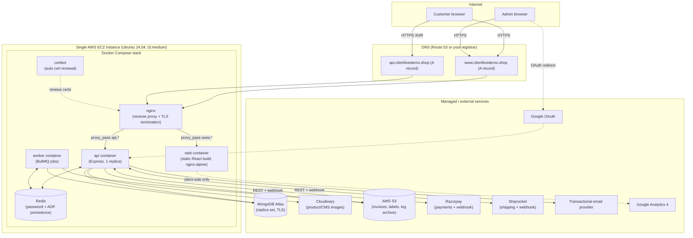

# BRENTIS HEALTHCARE — Production Deployment Guide

Written by inspecting this repository as it actually exists today (code, Dockerfiles, Compose files, nginx configs, scripts, env schema) — not a generic template. Every command below uses a real file in this repo; where something was missing or broken, it was fixed and is noted inline. Follow this guide top to bottom to go from a fresh AWS account to a live, HTTPS, monitored production deployment.

**Audience**: a developer who has never touched this project's infrastructure before. **Scope**: ~100 users/day initial traffic, India-based client, AWS + MongoDB Atlas + Cloudinary + Razorpay + Shiprocket.

> Two other deployment docs already exist in this repo (`docs/DEPLOYMENT.md`, `docs/MedCommerce_Local_to_EC2_Production_Deployment_Guide.md`). `DEPLOYMENT.md` in particular describes a topology (self-hosted Mongo, a `web` service, single-domain path routing) that **does not match the Compose/nginx files actually committed in this repo** — it was written ahead of the infrastructure, not after it. This guide reflects what's actually here, and completes the one piece that was missing (see §A.1). The git-workflow mechanics in the second doc (backup-before-deploy, `git pull --ff-only`, etc.) are accurate and this guide reuses them.

---

## Table of contents

- [A. Architecture and infrastructure](#a-architecture-and-infrastructure)
- [B. EC2 sizing and estimated cost](#b-ec2-sizing-and-estimated-cost)
- [C. Complete AWS setup](#c-complete-aws-setup)
- [D. MongoDB Atlas setup](#d-mongodb-atlas-setup)
- [E. Razorpay setup](#e-razorpay-setup)
- [F. Shiprocket setup](#f-shiprocket-setup)
- [G. Other third-party services](#g-other-third-party-services)
- [H. Environment variable reference](#h-environment-variable-reference)
- [I. Docker setup and local QA](#i-docker-setup-and-local-qa)
- [J. Production deployment procedure](#j-production-deployment-procedure)
- [K. Production checklist and troubleshooting](#k-production-checklist-and-troubleshooting)

---

## A. Architecture and infrastructure

### A.1 What's actually in this repo (as found)

This is a Turborepo/npm-workspaces monorepo: `apps/api` (Express 4 + Mongoose + TypeScript, built with `tsc`), `apps/web` (React 19 + Vite + TypeScript, built as a static SPA), `packages/shared` (shared Zod schemas/types, compiled to `dist/` and imported by both apps — **must be built first**, see §I).

The API process (`apps/api/src/server.ts`) and a separate **worker** process (`apps/api/src/worker.ts`, same Docker image, different `CMD`) both exist. The worker runs five BullMQ queues (invoice generation, notifications, shipment updates, order-fulfillment, maintenance) plus **in-process schedulers** for low-stock/expiry alerts, weekly sales reports, coupon expiry, prescription-expiry sweeps, document-retention sweeps, and a log-archival-to-S3 job (`apps/api/src/queues/jobs/*`). Redis (via BullMQ + `ioredis`) is a **hard requirement** for both `api` and `worker` — there's no fallback/disabled mode, unlike every third-party integration below.

Full infra already exists under `infra/`:
- `infra/docker/docker-compose.yml` — base: `nginx`, `api`, `worker`, `redis`
- `infra/docker/docker-compose.dev.yml` — full local dev stack (self-hosted Mongo as a single-node replica set, Redis, MinIO as an S3 stand-in, `mongo-express`, Vite dev server)
- `infra/docker/docker-compose.prod.yml` — production overrides (resource limits, replica counts, Redis auth+persistence, certbot)
- `infra/docker/docker-compose.monitoring.yml` — **opt-in** Prometheus + Grafana
- `infra/nginx/` — nginx config, already has a real, committed, domain-specific config for `api.clientlivedemo.shop` (`conf.d/default.conf` + `conf.d/ssl.conf`)
- `infra/scripts/` — `deploy.sh`, `rollback.sh`, `backup-mongo.sh`, `restore-mongo.sh`, `healthcheck.sh`, `init-letsencrypt.sh`, `cleanup-docker.sh`, `crontab.example`
- `infra/security/` — `setup-firewall.sh` (UFW), `jail.local` (Fail2Ban)

**The one real gap found**: `apps/web/Dockerfile` (a production-ready static build, nginx-served) existed but was **never wired into any production Compose file**, and nginx had no server block for the frontend domain at all — only for `api.clientlivedemo.shop`. The committed `ssl.conf` + `.env.aws`'s `WEB_BASE_URL=https://www.clientlivedemo.shop` make it clear the intended topology is a **subdomain split** (`www.<domain>` → frontend, `api.<domain>` → backend) — `infra/nginx/conf.d/ssl.conf.example` even documents this as the "Subdomain variant." This guide completes that: a `web` service was added to `docker-compose.prod.yml`, and two new nginx files (`conf.d/web.default.conf`, `conf.d/web.ssl.conf.example`) mirror the existing `api.*` pattern for the web subdomain. `apps/web/Dockerfile` itself also had three real, confirmed-by-building bugs (missing `packages/shared`/`tsconfig.base.json` copies, a missing nested `node_modules` copy) — fixed; see §I's QA report.

Also note: `vercel.json` exists at the repo root — some earlier point in this project considered deploying the frontend to Vercel instead. This guide does **not** use Vercel: the EC2+Docker approach above reuses the Docker image that already exists, needs no second hosting account/billing relationship, and keeps both subdomains on one TLS/cert/firewall surface. If you'd rather use Vercel for the frontend, skip the `web` service/nginx web.* files below and point `www.<domain>`'s DNS at Vercel instead — nothing else in this guide changes.

### A.2 Recommended architecture

| Concern | Choice | Why |
|---|---|---|
| Compute | **Single AWS EC2 instance** (Ubuntu 24.04 LTS), Docker Compose | ~100 users/day doesn't justify ECS/EKS or multi-instance; the existing Compose files are built for exactly this topology |
| Frontend hosting | **Same EC2**, Dockerized static build (nginx) | Reuses the Dockerfile that already exists; avoids a second platform/billing account |
| Database | **MongoDB Atlas** (managed), not self-hosted on EC2 | The app uses multi-document transactions (inventory/order flows) which require a replica set; Atlas is always one, self-hosting one on a single EC2 instance is unnecessary ops burden for this traffic. An Atlas cluster (`Cluster0`) already appears to exist for this project. |
| Cache/queue | **Redis, self-hosted on the same EC2** (Docker container, password + AOF persistence) | Required by BullMQ/rate-limiting; ElastiCache is overkill cost and complexity at 100 users/day — revisit only if you later run multiple API instances across multiple hosts |
| Images | **Cloudinary** | Already fully wired (`apps/api/src/integrations/cloudinary`); no infra decision needed |
| File storage | **AWS S3** (invoices, shipping labels, archived app logs) | Already wired with a self-disabling fallback to Cloudinary if unset; low cost at this volume |
| Reverse proxy / TLS | **nginx** (Docker container) + **Let's Encrypt** (via certbot, already scripted) | Free, already fully scripted in this repo (`init-letsencrypt.sh` + the `certbot` service); AWS Certificate Manager is the alternative but requires an AWS Application Load Balancer to attach to, which is unjustified extra cost/complexity for one EC2 instance |
| DNS | Your existing domain registrar, or **Route 53** | Either works; Route 53 costs ~$0.50/mo/zone if you want AWS to manage it, otherwise keep DNS at your current registrar and just add A records |
| Payments | **Razorpay** | Already wired (§E) |
| Shipping | **Shiprocket** | Already wired (§F) |

### A.3 Architecture diagram



---

## B. EC2 sizing and estimated cost

### B.1 Sizing

**Assumption**: ~100 users/day, typical e-commerce browsing/ordering pattern (not a flash-sale spike workload).

| Resource | Minimum (works, tight) | Recommended |
|---|---|---|
| Instance type | `t3.small` (2 vCPU, 2 GB RAM) | **`t3.medium` (2 vCPU, 4 GB RAM)** |
| EBS volume | 20 GB gp3 | **30 GB gp3** |
| Swap | 2 GB (required if using `t3.small`) | 2 GB (cheap insurance regardless) |

Why `t3.medium` over `t3.small`: `docker-compose.prod.yml`'s resource **limits** (ceilings, not steady-state usage) sum to roughly nginx 256 MB + web 128 MB + api 1 GB + worker 1 GB + redis 512 MB ≈ **2.9 GB**, before the OS, Docker daemon, and SSH/monitoring agents take their own share. A 2 GB instance has no margin if two services spike at once (e.g. a Puppeteer PDF render in `worker` during a traffic burst on `api`); you'd be relying entirely on swap, which is slow and masks real problems. `t3.medium`'s 4 GB gives real headroom at this traffic level without being wasteful — `t3` burstable instances also mean you're not paying for CPU you don't use most of the day. `docs/DEPLOYMENT.md` independently reached the same `t3.medium` conclusion.

**Don't over-provision**: do not jump to `t3.large`/`m5.large` or multi-instance/ECS for 100 users/day — that's solving a scaling problem you don't have yet. Revisit sizing when: CPU is consistently >60% during business hours, memory has no free headroom under `docker stats`, or you add a second API replica.

**Where Mongo/Redis live**: Mongo is **not on EC2 at all** (Atlas, §A.2/§D). Redis **is** on EC2 (self-hosted container) — this is why EC2 RAM matters more than it would in a fully-managed setup, and also why it's included in the sizing above.

### B.2 Backup and monitoring

- **Database backups**: `infra/scripts/backup-mongo.sh` (nightly, already scriptable via `infra/scripts/crontab.example`) dumps via `mongodump` directly from Atlas and optionally ships to S3. Atlas itself also offers **Cloud Backups** (continuous, point-in-time) on paid tiers (§D.6) — use both: Atlas backups for fast point-in-time recovery, the script's S3 copies as a second, independent copy outside Atlas's own infrastructure.
- **Monitoring**: `infra/scripts/healthcheck.sh` (cron, every 5 min, emails on failure) covers the basics for free. `infra/docker/docker-compose.monitoring.yml` (Prometheus + Grafana) is available as an **opt-in** add-on if you want dashboards/alerting beyond pass/fail — not required to go live, and both ports are firewalled off by default (reach them via SSH tunnel).
- **Log retention**: already built into the app itself (`AWS_S3_LOG_RETENTION_DAYS`, default 20 days) — see §H.

### B.3 Estimated monthly cost

All prices are **AWS `ap-south-1` (Mumbai) on-demand, as of this writing** — AWS and Atlas pricing changes over time; re-check the AWS Pricing Calculator and Atlas's pricing page before committing a client budget. **Excluded** (usage-based, not fixed infra cost): Razorpay's per-transaction fee (~2%), Shiprocket's per-shipment fee, SMS/WhatsApp if ever added, and any AWS data-transfer overage beyond the assumption below.

| Item | Assumption | Est. USD/mo | Est. INR/mo (₹84/USD) |
|---|---|---:|---:|
| EC2 `t3.medium`, on-demand | 730 hrs/mo | $30 | ₹2,520 |
| EBS gp3, 30 GB | — | $2.50 | ₹210 |
| Elastic IP | attached to a running instance (free) | $0 | ₹0 |
| Data transfer out | ~15 GB/mo (low traffic) | $1.50 | ₹125 |
| Route 53 hosted zone | optional, if not using your existing registrar's DNS | $0.50 | ₹42 |
| S3 (invoices/labels/log archive) | a few GB, low request volume | $1.50 | ₹125 |
| MongoDB Atlas | **M2 shared tier** (budget) — see §D.6 for why not M0 | $9 | ₹756 |
| **Total (lean)** | | **≈ $45/mo** | **≈ ₹3,780/mo** |
| MongoDB Atlas (alternative) | **M10 dedicated tier** — recommended once you have real revenue/data to protect | $57 | ₹4,788 |
| **Total (recommended once live with real orders)** | | **≈ $93/mo** | **≈ ₹7,800/mo** |

Cloudinary, your SMTP provider, Razorpay, and Shiprocket all have their **own separate free tiers / pay-as-you-go pricing** not included above — see §E/§F/§G for each. A domain name (if you don't already own `clientlivedemo.shop`) is a one-time/annual cost (~$10–15/yr), not a monthly AWS cost.

---

## C. Complete AWS setup

### C.1 Create an AWS account and configure billing alerts

1. Sign up at [aws.amazon.com](https://aws.amazon.com) if you don't have an account. Use a real business email, not a personal one tied to another AWS account.
2. **Enable MFA on the root account immediately** (IAM → Security credentials → Assign MFA device) — the root account should otherwise never be used day-to-day.
3. Set a budget alert: **Billing → Budgets → Create budget** → Monthly cost budget → set to e.g. $60 (above the lean estimate in §B.3) with an alert at 80% and 100% to your email.
4. Pick `ap-south-1` (Mumbai) as your default region for everything below — lowest latency for Indian users and matches the cost estimate.

### C.2 Create an IAM user/role with least-privilege permissions

**Never use the root account for day-to-day work or for the app's own AWS credentials.**

1. **IAM → Users → Create user** — name it e.g. `brentis-deploy`. This is for YOU (console/CLI access to manage the server), not the application.
2. Attach only what you need for this deployment: `AmazonEC2FullAccess` is reasonable for a single-instance setup (tightening further to instance-specific ARNs is optional hardening, not required to launch).
3. Create an **access key** for this user only if you need AWS CLI access from your own machine (Security credentials tab → Create access key → "Command Line Interface (CLI)"). Store it in `~/.aws/credentials`, never in the repo.
4. **For the application's own S3 access** (not your personal access): prefer an **IAM role attached to the EC2 instance** over static keys baked into `.env.production` — see §C.8 and §H. This is the single most important AWS security practice in this guide: it means `AWS_ACCESS_KEY_ID`/`AWS_SECRET_ACCESS_KEY` can be left **empty** in production, and nothing leaks if the server is ever compromised or the `.env.production` file is ever mishandled.

### C.3 Create the EC2 instance

1. **EC2 → Launch instance**.
2. **Name**: `brentis-healthcare-prod`.
3. **AMI**: search "Ubuntu" → select **Ubuntu Server 24.04 LTS (HVM), SSD Volume Type**, 64-bit (Arm) or (x86) — either works with this repo's Docker images (multi-arch base images), but x86_64 (`t3.medium` is x86) is simplest and matches every command in this guide.
4. **Instance type**: `t3.medium` (see §B.1).
5. **Key pair**: create a new one (e.g. `brentis-prod-key`), download the `.pem`, `chmod 400` it locally. You cannot download it again later — store it safely (password manager / secrets vault), not in this repo.
6. **Network settings**: create a new security group (see §C.4 — don't accept the defaults, you'll edit this next).
7. **Storage**: 30 GB, **gp3** (not the default gp2 — gp3 is cheaper and faster at this size).
8. **Launch**.
9. **Allocate an Elastic IP** (EC2 → Elastic IPs → Allocate) and **associate it with this instance** — do this before configuring DNS (§C.9), so DNS never has to change later. A plain EC2 public IP changes if the instance stops/starts; an Elastic IP doesn't (and is free while attached to a running instance).

### C.4 Security groups

On the instance's security group, set **inbound rules** to exactly:

| Type | Port | Source | Why |
|---|---|---|---|
| SSH | 22 | **Your IP only** (`x.x.x.x/32`) — use "My IP" in the console, not `0.0.0.0/0` | Minimizes brute-force exposure |
| HTTP | 80 | `0.0.0.0/0` | Required for Let's Encrypt's ACME challenge + HTTP→HTTPS redirect |
| HTTPS | 443 | `0.0.0.0/0` | Actual app traffic |

Deliberately **do not** open: 5000 (API — only reachable via nginx), 6379 (Redis), 9090/3001 (Prometheus/Grafana, if you enable monitoring — reach via SSH tunnel). This is the AWS-side firewall layer; §C.7's UFW setup is the second, host-side layer — **both** must agree, or nothing works (both allow, or the traffic is blocked).

**Outbound rules**: leave the default (`All traffic, 0.0.0.0/0`) — the app needs outbound HTTPS to Atlas, Cloudinary, Razorpay, Shiprocket, SMTP, S3, Google.

### C.5 EBS volume

Already sized at launch (§C.3 step 7, 30 GB gp3). To resize later without downtime: **EC2 → Volumes → select the volume → Actions → Modify volume** → increase size → then on the instance: `sudo growpart /dev/xvda 1 && sudo resize2fs /dev/xvda1` (adjust device name if different — check with `lsblk` first).

### C.6 Connect to EC2 via SSH

```bash
chmod 400 ~/Downloads/brentis-prod-key.pem
ssh -i ~/Downloads/brentis-prod-key.pem ubuntu@<your-elastic-ip>
```

(`ubuntu` is the default user on the Ubuntu AMI — not `ec2-user`, which is Amazon Linux's default.)

### C.7 Install Docker, Docker Compose, and required packages

```bash
sudo apt-get update
sudo apt-get install -y ca-certificates curl gnupg
sudo install -m 0755 -d /etc/apt/keyrings
curl -fsSL https://download.docker.com/linux/ubuntu/gpg | sudo gpg --dearmor -o /etc/apt/keyrings/docker.gpg
echo "deb [arch=$(dpkg --print-architecture) signed-by=/etc/apt/keyrings/docker.gpg] https://download.docker.com/linux/ubuntu $(. /etc/os-release && echo $VERSION_CODENAME) stable" | sudo tee /etc/apt/sources.list.d/docker.list > /dev/null
sudo apt-get update
sudo apt-get install -y docker-ce docker-ce-cli containerd.io docker-compose-plugin

sudo usermod -aG docker $USER
newgrp docker   # or log out/in

docker --version && docker compose version
```

**Add swap** (cheap insurance against a build/traffic spike OOM-killing something):

```bash
sudo fallocate -l 2G /swapfile && sudo chmod 600 /swapfile
sudo mkswap /swapfile && sudo swapon /swapfile
echo '/swapfile none swap sw 0 0' | sudo tee -a /etc/fstab
free -h   # confirm swap shows up
```

**Firewall** (UFW — host-side layer, see §C.4 for the AWS-side layer):

```bash
cd /opt/brentis-healthcare   # after cloning, see §J.1 — or run this step after §J.1 if doing it in order
sudo ./infra/scripts/setup-firewall.sh
```

This denies everything inbound except SSH/80/443 — matches §C.4's security group exactly (defense in depth: if the security group were ever misconfigured, UFW is a second line of defense, and vice versa).

**Optional but recommended — Fail2Ban** (bans repeated SSH/auth-abuse IPs):

```bash
sudo apt-get install -y fail2ban
sudo cp infra/security/jail.local /etc/fail2ban/jail.local
sudo systemctl restart fail2ban
```

### C.8 S3 bucket + IAM role (prefer a role over static keys)

1. **S3 → Create bucket**: name it e.g. `brentis-healthcare-prod` (bucket names are globally unique — adjust if taken), region `ap-south-1`. Leave **Block all public access ON** (the app only ever uses short-lived presigned URLs, never public bucket ACLs — see `apps/api/src/integrations/s3/storage.service.ts`).
2. **Enable versioning** (optional, cheap insurance against accidental overwrite — Properties tab → Bucket Versioning → Enable).
3. **IAM role for the EC2 instance** (the recommended approach — see §C.2):
   - **IAM → Roles → Create role** → Trusted entity type: **AWS service** → Use case: **EC2**.
   - Attach a **custom policy** (not `AmazonS3FullAccess` — least privilege) scoped to just this bucket:
     ```json
     {
       "Version": "2012-10-17",
       "Statement": [
         {
           "Effect": "Allow",
           "Action": ["s3:PutObject", "s3:GetObject", "s3:DeleteObject", "s3:ListBucket"],
           "Resource": [
             "arn:aws:s3:::brentis-healthcare-prod",
             "arn:aws:s3:::brentis-healthcare-prod/*"
           ]
         }
       ]
     }
     ```
   - Name the role `brentis-api-s3-role`.
   - **EC2 → select your instance → Actions → Security → Modify IAM role** → attach `brentis-api-s3-role`.
4. With the role attached, the AWS SDK on the instance picks up credentials automatically via the instance metadata service — **leave `AWS_ACCESS_KEY_ID`/`AWS_SECRET_ACCESS_KEY` empty** in `.env.production` (see §H). Only set `AWS_REGION` and `AWS_S3_BUCKET`.
   - If you'd rather use static keys instead (simpler to reason about, slightly worse security posture): **IAM → Users → Create user** (e.g. `brentis-s3-app-user`) with the same custom policy attached directly, then create an access key for it and put those in `.env.production`.

### C.9 Domain DNS and HTTPS

At your DNS provider (or Route 53, if you chose to delegate there — see §A.2), create **two A records**, both pointing at the Elastic IP from §C.3:

| Name | Type | Value |
|---|---|---|
| `www.clientlivedemo.shop` | A | `<your-elastic-ip>` |
| `api.clientlivedemo.shop` | A | `<your-elastic-ip>` |
| `clientlivedemo.shop` (apex, optional) | A | `<your-elastic-ip>` |

Wait for propagation (`dig www.clientlivedemo.shop` / `dig api.clientlivedemo.shop` should return the Elastic IP — usually minutes, can take up to ~48h depending on your registrar's TTL) before issuing TLS certificates in §J.8.

### C.10 Deploy the application and configure automatic restart

Covered fully in §J — this is the step where everything above comes together. Automatic restart is already built in: every service in `docker-compose.prod.yml` has `restart: unless-stopped` or `restart_policy: {condition: on-failure, max_attempts: 5}`, so a container crash or a server reboot both self-heal without manual intervention.

### C.11 Logs, monitoring, backups, recovery

Covered in §J.12 and §K.

---

## D. MongoDB Atlas setup

### D.1 Create a project and cluster

1. Sign up / log in at [cloud.mongodb.com](https://cloud.mongodb.com).
2. **Create a new Project** — e.g. "Brentis Healthcare".
3. **Build a database** → choose a tier (see §D.6 for which one) → **Provider: AWS, Region: Mumbai (ap-south-1)** — same region as EC2, minimizes latency and avoids any cross-region data transfer cost.
4. Name the cluster (e.g. `Cluster0` — the default name is fine and is what this project's existing local config already uses).

### D.2 Create a database user

**Database Access → Add New Database User**:
- Authentication method: **Password**.
- Username: e.g. `brentis_api_prod` (a **dedicated** user for this purpose — don't reuse a personal/admin Atlas login).
- **Database User Privileges: "Read and write to any database"** is acceptable for a single-app deployment, but prefer **"Grant specific privileges"** scoped to just `readWrite` on the `medcommerce` database if you want tighter least-privilege.
- Generate a strong password (Atlas can generate one for you) — copy it immediately, you'll need it for the connection string. Store it in your secrets manager, not in chat/docs.

### D.3 Configure network access securely

**Network Access → Add IP Address**:
- Add **your EC2 instance's Elastic IP** (`<your-elastic-ip>/32`) — not `0.0.0.0/0`.
- **Never use "Allow access from anywhere" (`0.0.0.0/0`) in production** — this is the single most common MongoDB Atlas misconfiguration and directly contradicts the "do not expose MongoDB publicly" requirement.
- If you also need access from your own machine for debugging (e.g. `mongosh` or Compass), add your current IP as a **separate** entry, and remove it when done rather than leaving it indefinitely.

### D.4 Get the connection string

**Database → Connect → Drivers** → select Node.js, any recent version. Copy the connection string, which looks like:

```
mongodb+srv://<username>:<password>@cluster0.xxxxx.mongodb.net/?retryWrites=true&w=majority&appName=Cluster0
```

Add your database name explicitly after the host (Atlas's copy-paste string often omits it, which would make the app connect to a default/`test` database): `.../medcommerce?retryWrites=true&w=majority`. This full string is your `MONGO_URI` for `.env.production` (§H) — **never commit it anywhere**.

### D.5 Database name and permissions

Use a single logical database, e.g. `medcommerce` (matches this app's existing local/dev convention — `apps/api` doesn't hardcode the name, it comes entirely from `MONGO_URI`'s path segment). The app creates its own collections/indexes on first use via Mongoose — no manual schema setup needed in Atlas.

### D.6 Backups and production tier

- **Do not use the free M0 tier for production.** M0 has no backups, is a shared cluster with resource caps that can throttle under load, and isn't intended for real traffic — it's for prototyping only.
- **Minimum practical production tier: M2 or M5 (shared, ~$9–25/mo)** — acceptable to start at 100 users/day if budget is tight, but has the same "shared cluster" caveat as M0 (no dedicated resources, basic backup only).
- **Recommended once there's real customer data/revenue to protect: M10 (dedicated, ~$57/mo)** — dedicated resources, and unlocks **Cloud Backups** (continuous, point-in-time restore) under **Backup → Enable Continuous Backup**. Set a retention policy matching your business needs (e.g. 7 daily + 4 weekly snapshots).
- Either way, also keep `infra/scripts/backup-mongo.sh`'s independent S3 copies running (§B.2) — a second, Atlas-infrastructure-independent backup.

### D.7 Connect the Dockerized app on EC2 to Atlas

Nothing special — the app connects to Atlas exactly like any other MongoDB client. Put the connection string from §D.4 into `MONGO_URI` in `.env.production` on the EC2 instance (§H, §J.3). Confirm connectivity once the `api` container is running:

```bash
docker compose -f infra/docker/docker-compose.yml -f infra/docker/docker-compose.prod.yml logs api | grep -i mongo
```

You should see a successful connection log, not a timeout/auth error. If it hangs or times out, re-check §D.3 (your EC2 IP must be allow-listed) before anything else.

---

## E. Razorpay setup

Razorpay account approval is **not instant** — budget a few business days for KYC review before you can go live with real payments. Everything below reflects the real onboarding flow, not an idealized one.

### E.1 Create a Razorpay business account

1. Sign up at [razorpay.com](https://razorpay.com) with a business email.
2. You'll land in **Test Mode** immediately — you can integrate and test the full payment flow before KYC is even submitted (see §E.8).

### E.2 Complete KYC and business verification

**Account & Settings → Activate your account (or similar prompt on first login)**. Razorpay will ask for:
- Business type (Private Limited / Partnership / Proprietorship / etc.)
- **GSTIN** (you confirmed the client has this)
- **PAN** (business PAN, or proprietor's PAN for a sole proprietorship)
- **Current account** bank details (confirmed available) — Razorpay settles payouts here; a savings account is not accepted for a business account
- Business category/sub-category (choose the closest match to "healthcare e-commerce / pharmacy" — the exact category affects which payment methods and risk review apply)
- Website URL (must be live and show the business's actual offerings, refund/shipping/privacy policies, and contact details — Razorpay's reviewers check this; this app already has Terms/Privacy/Return/Shipping/Refund/Cancellation policy pages, which covers this requirement)

### E.3 Provide required documents

Typically required (exact list can vary by business type): GSTIN certificate, PAN card, certificate of incorporation/partnership deed/proprietorship proof (as applicable), a canceled cheque or bank statement for the current account, and a business address proof. Upload via the same Activation flow.

### E.4 Configure website details and business information

Razorpay reviews your live site as part of activation — make sure before submitting: the site is reachable over HTTPS (so this means after §J.8, not before), policy pages are real/filled in (not placeholder text), and pricing/contact info is accurate.

### E.5 Activate payment methods

Once KYC is approved, go to **Account & Settings → Payment Methods** and enable the methods you want: Cards, UPI, Netbanking, Wallets, etc. UPI is typically the highest-conversion method for Indian consumer checkout.

### E.6 Obtain Test and Live API keys

**Settings → API Keys**:
- **Test keys** (`rzp_test_...`) are available immediately, no approval needed — use these during development and for the local-QA/staging testing in §I.
- **Live keys** (`rzp_live_...`) only become available **after KYC approval**. Generate them, and treat the key secret like any other production credential (§H) — never commit it, never log it.

### E.7 Configure payment verification and webhook secret

Razorpay signs every webhook payload with HMAC-SHA256 using a **webhook secret** you set — this app verifies it in `apps/api/src/modules/payments/webhook.routes.ts` against the raw request body (not the parsed JSON, which is why that route is mounted with `express.raw()`, not `express.json()`).

### E.8 Set the production webhook URL and required events

**Settings → Webhooks → Add New Webhook**:
- **Webhook URL**: `https://api.clientlivedemo.shop/api/v1/webhooks/razorpay` (confirmed from the actual route mount in `apps/api/src/app.ts`: `app.use('/api/v1/webhooks', ...)` + `webhookRouter.post('/razorpay', ...)`).
- **Secret**: generate a strong random value (e.g. `openssl rand -hex 32`), enter it here, and put the **same value** in `RAZORPAY_WEBHOOK_SECRET` (§H) — they must match exactly or every webhook will be rejected with a signature-mismatch error.
- **Active events**: at minimum `payment.captured`, `payment.failed`, `order.paid`; add others depending on which flows the business needs (check `apps/api/src/modules/payments/payment.service.ts`'s `handleRazorpayWebhookEvent` for the exact set this app currently handles before enabling events it won't act on).
- You can set this webhook up in **Test Mode first** (pointing at a staging/ngrok URL during development) and again in **Live Mode** once you flip the dashboard toggle — they're entirely separate webhook configurations.

### E.9 Test Mode vs Live Mode

| | Test Mode | Live Mode |
|---|---|---|
| Keys | `rzp_test_...` | `rzp_live_...` |
| Requires KYC approval | No | Yes |
| Real money moves | No (use Razorpay's test card numbers/UPI VPAs) | Yes |
| Webhook config | Separate, configured independently | Separate, configured independently |
| Where to use | Local dev, `.env.local-qa`, staging | `.env.production` only |

**Never put live keys in anything other than the actual production environment** — not in `.env.local-qa`, not in a shared dev `.env`, not in this repo in any form.

### E.10 Test the full payment flow before going live

With **test** keys configured and the webhook pointed at a reachable URL (use `ngrok http 5000` locally, or point it at a staging deployment if you have one):

1. **Successful payment**: place a test order, pay with Razorpay's documented test card (`4111 1111 1111 1111`, any future expiry, any CVV) or a test UPI VPA — confirm the order flips to paid in the admin panel and the webhook log shows `payment.captured`.
2. **Failed payment**: use a card number Razorpay documents as a guaranteed-decline test card — confirm the order is marked failed, not left in a stuck "pending" state, and no inventory is reserved/decremented for it.
3. **Cancellation**: abandon checkout after creating a Razorpay order but before paying — confirm there's no orphaned "paid" state and the order correctly shows as unpaid/abandoned.
4. **Webhook retries**: Razorpay retries a webhook delivery if your endpoint doesn't return 2xx within its timeout — temporarily point the webhook at an unreachable URL, trigger a payment, then fix the URL and confirm Razorpay's retry eventually reaches you (check the Webhooks tab's delivery log, which shows attempt history).

---

## F. Shiprocket setup

### F.1 Create a Shiprocket business account

Sign up at [shiprocket.in](https://www.shiprocket.in) with business details. Like Razorpay, full activation requires document review — you can explore the dashboard immediately but need approval before live order creation/AWB generation works.

### F.2 Complete account/business verification

Shiprocket will ask for GSTIN, business PAN, and bank details for COD remittance (if you'll offer Cash on Delivery). Upload via **Settings → Company Profile**.

### F.3 Configure pickup address and warehouse information

**Settings → Pickup Addresses → Add New Address** — enter the actual warehouse/dispatch location. This becomes available as a "pickup location" name, which this app references via `SHIPROCKET_PICKUP_LOCATION` (§H) — the **name** must match exactly what's configured here (confirmed from `apps/api/src/integrations/shiprocket/shiprocket.client.ts`'s `getShiprocketPickupLocationName()`).

### F.4 Add GST and business details

Same **Settings → Company Profile** area as F.2 — GSTIN is required for generating GST-compliant shipping documents/invoices through Shiprocket.

### F.5 Configure pickup locations

If there's more than one dispatch point (e.g. multiple warehouses later), add each as a separate pickup address — this app currently uses a single `SHIPROCKET_PICKUP_LOCATION` value, so for now, configure and use just the one primary pickup location.

### F.6 Obtain API credentials

Shiprocket's API authenticates with **email + password** (not a separate API key) — **Settings → API → User API** shows/creates API credentials, but functionally the app logs in with whatever email/password you configure here, exactly like a dashboard login (confirmed from `shiprocket.client.ts`'s `authenticate()`, which POSTs to `/auth/login`). Consider creating a **dedicated API user** (if Shiprocket's plan supports it) rather than reusing your own personal dashboard login, so you can revoke/rotate API access without locking yourself out of the dashboard.

### F.7 Configure production API access

`SHIPROCKET_BASE_URL` defaults to `https://apiv2.shiprocket.in/v1/external` (already the production API — Shiprocket doesn't maintain a separate sandbox base URL the way Razorpay does; test carefully with real-but-cancelable test orders instead).

### F.8 Configure webhook URL and authentication token

**Settings → API → Webhooks** (or wherever Shiprocket's current dashboard surfaces this — their UI has moved this before):
- **Webhook URL**: `https://api.clientlivedemo.shop/api/v1/webhooks/shiprocket` (confirmed from `apps/api/src/app.ts` + `webhook.routes.ts`'s `/shiprocket` route).
- **Token**: Shiprocket echoes back a static token on each webhook call (via an `x-api-key` or `x-shiprocket-token` header — this app checks both, see `webhook.routes.ts`). Generate a strong token, set it here, and put the same value in `SHIPROCKET_WEBHOOK_TOKEN` (§H).

### F.9 Test the full shipping flow

With a real (even if small/test) order created end-to-end through the app:

1. **Order creation**: confirm the order appears in Shiprocket's dashboard after checkout (check `apps/api/src/modules/orders/shiprocket-fulfillment.service.ts`'s logs/the admin order detail page for a Shiprocket order ID).
2. **AWB generation**: assign a courier and generate an AWB (air waybill number) from the admin panel — confirm it's reflected on the order.
3. **Shipping label**: generate and download the label — confirm it's a valid PDF with the correct pickup/delivery address.
4. **Pickup**: schedule a pickup (or manual drop-off per your courier's process) and confirm the status updates.
5. **Tracking**: confirm tracking updates flow back via the webhook (§F.8) and update the order's shipment status in the admin panel — this is the main thing the webhook integration exists for.
6. **Cancellation**: cancel a test shipment before pickup and confirm the order's status reflects it correctly (not left showing "shipped").
7. **Delivery updates**: if feasible, let one real low-value test order go through to actual delivery, confirming the final "delivered" webhook lands correctly.

---

## G. Other third-party services

### G.1 Cloudinary

1. Sign up at [cloudinary.com](https://cloudinary.com) — the free tier (25 monthly credits, roughly 25 GB combined storage+bandwidth+transformations) is enough to start.
2. **Dashboard** shows your **Cloud name**, **API Key**, **API Secret** directly — these map to `CLOUDINARY_CLOUD_NAME`/`CLOUDINARY_API_KEY`/`CLOUDINARY_API_SECRET` (§H).
3. No manual upload-preset configuration needed — `apps/api/src/integrations/cloudinary/cloudinary.service.ts`'s `ensureUploadPreset()` auto-creates any preset it needs on first use.
4. **Use a separate Cloudinary account/cloud for production vs. local dev** — don't let test uploads and real product images share one cloud (makes cleanup and quota tracking harder, and a local-dev mistake could delete/overwrite a real production asset).

### G.2 Google OAuth / Google Cloud Console

Used for both **admin** "Continue with Google" login and **customer** "Continue/Sign up with Google" (two separate resolution policies in the same app — see `apps/api/src/modules/auth/google-auth.service.ts`).

1. [console.cloud.google.com](https://console.cloud.google.com) → create a project (or reuse an existing one) → **APIs & Services → Credentials → Create Credentials → OAuth client ID**.
2. **Application type: Web application**.
3. **Authorized JavaScript origins**: add `https://www.clientlivedemo.shop` (the frontend origin — needed even though this app's OAuth flow is a full-page redirect rather than a popup, Google still validates this field).
4. **Authorized redirect URIs**: add **exactly** `https://api.clientlivedemo.shop/api/v1/auth/google/callback` — must match `GOOGLE_CALLBACK_URL` (§H) **character for character**, including scheme (`https`) and no trailing slash, or Google returns `Error 400: redirect_uri_mismatch`.
5. **Production domain configuration**: once you have real users, go to **OAuth consent screen** and move it from "Testing" to "In production" (Google otherwise limits Testing-mode apps to 100 explicitly-added test users) — this requires a privacy policy URL (this app has one: `https://www.clientlivedemo.shop/privacy-policy`) and may trigger Google's verification review depending on the scopes requested (this app only requests `openid email profile` — low-risk, usually fast/no extra review).
6. **Backend token verification**: already correctly implemented — the backend never trusts a client-supplied identity; it exchanges the OAuth `code` server-side and verifies the ID token via `google-auth-library`'s `OAuth2Client.verifyIdToken()` (see `google-auth.service.ts`). No action needed here beyond getting the client ID/secret into `.env.production`.
7. Put the Client ID, Client Secret, and callback URL into `GOOGLE_CLIENT_ID`/`GOOGLE_CLIENT_SECRET`/`GOOGLE_CALLBACK_URL` (§H), and enable the relevant toggle(s) in the Super Admin Configuration page (both the env vars AND the DB config flag are required — confirmed from `auth-config.service.ts`).

### G.3 Email: Gmail SMTP vs. a production provider

**This app's local/dev config currently uses Gmail SMTP with an App Password** (`smtp.gmail.com:587`). **Do not use this in production.** Specific, real limitations:

- **Sending limits**: a standard Gmail account caps outbound mail at **500 messages/day** (Google Workspace accounts: 2,000/day) — for OTP + password-reset + order-confirmation + shipment-update emails combined, 100 users/day can plausibly exceed this once the store is actually busy.
- **Deliverability**: Gmail SMTP relay isn't designed for transactional/bulk sending from an application; messages are more likely to be rate-limited, throttled, or flagged as spam by recipient providers, especially once volume grows.
- **Google ToS risk**: using a personal/business Gmail mailbox as an application SMTP relay is against Gmail's intended use and can result in the account being flagged or suspended with no warning.

**Recommended production providers** (any one of these — all speak standard SMTP, so no code changes are needed, just `.env.production` values):

| Provider | Why | Approx. cost at this volume |
|---|---|---|
| **AWS SES** | Cheapest, same-cloud as EC2, good deliverability once out of sandbox mode | ~$0.10 per 1,000 emails (negligible at 100 users/day) |
| **Postmark** | Best-in-class deliverability for transactional email, simple setup | Free tier (100/mo), then ~$15/mo for 10k |
| **SendGrid** | Widely used, generous free tier | Free tier (100/day), then paid tiers |

**If using AWS SES**: it starts in a **sandbox** (can only send to verified email addresses) — request **Production Access** via the SES console (Account dashboard → Request production access), which is a short form reviewed by AWS, typically approved within a day. Verify your sending domain (`clientlivedemo.shop`) via DNS (SES gives you DKIM CNAME records to add) for best deliverability — don't send from an unverified/shared domain.

Whichever you choose, set `SMTP_HOST`/`SMTP_PORT`/`SMTP_USER`/`SMTP_PASS`/`SMTP_FROM` accordingly (§H) — `SMTP_FROM` should be an address on your real domain (e.g. `no-reply@clientlivedemo.shop`), not `gmail.com`.

### G.4 Google Analytics

1. [analytics.google.com](https://analytics.google.com) → create a **GA4 property** for `www.clientlivedemo.shop`.
2. **Admin → Data Streams → Web** → add a stream for `https://www.clientlivedemo.shop` → copy the **Measurement ID** (`G-XXXXXXXXXX`).
3. This goes into `VITE_GA_MEASUREMENT_ID` — **not** a root `.env` variable (it's a frontend **build-time** value, baked into the static bundle at `docker compose build` time via a build arg — see `apps/web/Dockerfile` and `docker-compose.prod.yml`'s `web` service, §I/§J).
4. GA is **dual-gated** in this app (confirmed from `apps/web/src/lib/analytics.ts`): both `VITE_GA_MEASUREMENT_ID` being set at build time AND a `googleAnalyticsEnabled` flag in the Super Admin Configuration UI must be true — set both.
5. **Two env vars already present in this repo's local `.env` are unused and should be removed** — `GOOGLE_ANALYTICS_STREAM_ID`/`GOOGLE_ANALYTICS_MEASUREMENT_ID` do not appear anywhere in the actual application code (only `VITE_GA_MEASUREMENT_ID` is read). See §H.4.

### G.5 Redis

Already covered architecturally in §A.2 (self-hosted on the same EC2, password + AOF persistence via `docker-compose.prod.yml`). No external account/signup needed — just set `REDIS_URL`/`REDIS_PASSWORD` (§H) once the `redis` container is running.

### G.6 AWS S3

Covered fully in §C.8.

---

## H. Environment variable reference

### H.1 Which file is which

| File | Used for | Committed to git? |
|---|---|---|
| `.env.example` | Template for local dev's `.env` | Yes (placeholders only) |
| `.env` | Actual local dev values | **No** (gitignored) |
| `.env.local-qa.example` | Template for testing the real production Docker images locally (§I) | Yes (placeholders only) |
| `.env.local-qa` | Actual local-QA values | **No** (gitignored — newly added to `.gitignore` by this guide's changes) |
| `.env.production.example` | Template for the real EC2 deployment | Yes (placeholders only) |
| `.env.production` → copied to `.env` on EC2 | Actual production values | **No** (gitignored) |

See `docs/MedCommerce_Local_to_EC2_Production_Deployment_Guide.md` §5 for why production needs both `.env.production` AND a copy at `.env` (two different mechanisms read them — Compose's `env_file:` for the containers' actual runtime env, and `--env-file` for Compose's own `${VAR}` substitution inside the YAML).

### H.2 Full variable reference

Every variable below was found either in `packages/shared/src/schemas/env.schema.ts` (the authoritative, Zod-validated contract the API refuses to boot without satisfying) or by grepping actual `process.env`/`import.meta.env` usage across `apps/api/src` and `apps/web/src`. "Required" means the app won't start without it; everything else defaults to empty/a sane default and the corresponding integration **self-disables** rather than crashing.

| Variable | Purpose | Required | Local example | Production configuration |
|---|---|:---:|---|---|
| `NODE_ENV` | Runtime mode | No (default `development`) | `development` | `production` |
| `PORT` | API listen port | No (default `5000`) | `5000` | `5000` (internal — nginx is what's actually exposed) |
| `API_BASE_URL` | Base URL the API considers itself reachable at | **Yes** | `http://localhost:5000` | `https://api.clientlivedemo.shop` |
| `WEB_BASE_URL` | Used to build links in emails (password reset, verification) | **Yes**, no default | `http://localhost:5173` | `https://www.clientlivedemo.shop` |
| `CORS_ORIGIN` | Allowed browser origin for API requests | **Yes** | `http://localhost:5173` | `https://www.clientlivedemo.shop` |
| `MONGO_URI` | MongoDB connection string | **Yes** | local Atlas dev cluster | Atlas **production** cluster, dedicated DB user (§D) |
| `REDIS_URL` | Redis connection string (BullMQ + rate limiting) | **Yes** | `redis://localhost:6379` | `redis://:<password>@redis:6379` (password required, see `REDIS_PASSWORD` below) |
| `REDIS_PASSWORD` | Redis AUTH password (read directly by `docker-compose.prod.yml`'s `redis` service, not by the app's env schema) | **Yes in production** (`${REDIS_PASSWORD:?}` — Compose refuses to start without it) | n/a (dev Redis has no password) | Generate: `openssl rand -base64 24` — **must exactly match** the password embedded in `REDIS_URL` above |
| `JWT_ACCESS_SECRET` | Signs access tokens | **Yes**, min 32 chars | any 32+ char string | `openssl rand -base64 48` — **unique to production**, never reused from dev |
| `JWT_ACCESS_EXPIRES_IN` | Access token TTL | No (default `15m`) | `15m` | `15m` |
| `JWT_REFRESH_EXPIRES_IN_DAYS` | Refresh token TTL | No (default `30`) | `30` | `30` |
| `REFRESH_TOKEN_COOKIE_NAME` | Cookie name for the refresh token | No (default `mc_refresh_token`) | `mc_refresh_token` | `mc_refresh_token` |
| `CONFIG_ENCRYPTION_KEY` | Encrypts third-party secrets saved via the admin Configuration UI (instead of env vars) | No, but **required** if that UI is ever used for a real secret | blank | `openssl rand -base64 32` |
| `CLOUDINARY_CLOUD_NAME` | Cloudinary account | No (self-disables) | your dev cloud | production cloud (§G.1) |
| `CLOUDINARY_API_KEY` | — | No | — | — |
| `CLOUDINARY_API_SECRET` | — | No | — | — |
| `RAZORPAY_KEY_ID` | Payments (or set via admin Configuration UI instead) | No (self-disables) | `rzp_test_...` | `rzp_live_...` once KYC-approved (§E.6) |
| `RAZORPAY_KEY_SECRET` | — | No | — | — |
| `RAZORPAY_WEBHOOK_SECRET` | Verifies webhook HMAC | No | — | Must match the dashboard-configured webhook exactly (§E.7) |
| `SMTP_HOST` | Transactional email | No (self-disables) | `smtp.gmail.com` | SES/Postmark/SendGrid host — **not Gmail** (§G.3) |
| `SMTP_PORT` | — | No (default `587`) | `587` | `587` |
| `SMTP_USER` | — | No | — | — |
| `SMTP_PASS` | — | No | — | — |
| `SMTP_FROM` | — | No (default `no-reply@medcommerce.example.com` — **replace this**, it's a placeholder domain) | `no-reply@example.com` | `no-reply@clientlivedemo.shop` |
| `GOOGLE_CLIENT_ID` | OAuth (admin + customer login) | No (self-disables) | blank or a dev OAuth client | production OAuth client (§G.2) |
| `GOOGLE_CLIENT_SECRET` | — | No | — | — |
| `GOOGLE_CALLBACK_URL` | Must match an Authorized redirect URI exactly | No | `http://localhost:5000/api/v1/auth/google/callback` | `https://api.clientlivedemo.shop/api/v1/auth/google/callback` |
| `SHIPROCKET_EMAIL` | Shiprocket login (or set via admin Configuration UI instead) | No (self-disables) | blank | production Shiprocket account email (§F.6) |
| `SHIPROCKET_PASSWORD` | — | No | — | — |
| `SHIPROCKET_BASE_URL` | Shiprocket API base | No (default `https://apiv2.shiprocket.in/v1/external` — already production, no separate sandbox) | default | default |
| `SHIPROCKET_PICKUP_LOCATION` | Must match a configured pickup address name exactly | No | — | from §F.3 |
| `SHIPROCKET_WEBHOOK_TOKEN` | Verifies webhook auth | No | — | Must match the dashboard-configured value exactly (§F.8) |
| `AWS_REGION` | S3 region | No (self-disables) | blank or `us-east-1` for local MinIO | `ap-south-1` |
| `AWS_ACCESS_KEY_ID` | S3 credentials | No | MinIO root user (local only) | **leave empty — use an IAM role instead** (§C.8) |
| `AWS_SECRET_ACCESS_KEY` | — | No | MinIO root password (local only) | **leave empty — use an IAM role instead** |
| `AWS_S3_BUCKET` | Bucket name | No | local MinIO bucket | `brentis-healthcare-prod` |
| `AWS_S3_LOG_RETENTION_DAYS` | App log retention in S3 | No (default `20`) | `20` | `20` (or adjust per compliance needs) |
| `AWS_S3_ENDPOINT` | **Only** for non-AWS S3-compatible endpoints (MinIO) | No | MinIO URL for local dev | **must be empty** — leaving a MinIO endpoint set in production silently points the "AWS S3" client at a fake local server |
| `AWS_S3_DOCUMENT_RETENTION_DAYS` | Invoice/label document retention in S3 | No (default `30`) | `30` | `30` (or per business/legal retention requirement) |
| `GOOGLE_ANALYTICS_STREAM_ID` / `GOOGLE_ANALYTICS_MEASUREMENT_ID` | — | — | — | **Remove — see §H.4, these are unused/orphaned** |
| `VITE_GA_MEASUREMENT_ID` | GA4 ID (frontend build-time, **not** a root `.env` var — see `apps/web/.env.example` / Docker build arg) | No (self-disables) | blank | from §G.4, passed as a `docker compose build` arg |
| `REDIS_URL`/`REDIS_PASSWORD` | (see above, grouped for clarity) | | | |
| `LOG_LEVEL` | Pino log verbosity | No (default `info`) | `info` | `info` (or `warn` to reduce volume) |
| `RATE_LIMIT_WINDOW_MS` | API rate-limit window | No (default `60000`) | `60000` | `60000` |
| `RATE_LIMIT_MAX` | Requests per window | No (default `100`) | `100` | `100` (tune up/down based on real traffic patterns once observed) |
| `LOG_TIMEZONE` | Log rotation timezone | No (default `UTC`) | `UTC` | `UTC` or `Asia/Kolkata` |
| `LOG_ROTATION_HOURS` | How often local logs rotate | No (default `6`) | `6` | `6` |
| `LOG_DIRECTORY` | Override log directory | No (default: app's own `logs/` dir) | blank | blank |
| `LOG_S3_PREFIX` | S3 key prefix for archived logs | No (default `logs/`) | `logs/` | `logs/` |
| `LOG_S3_ARCHIVAL_ENABLED` | Toggle the S3 log-archival worker | No (default `true`) | `true` | `true` (requires AWS_S3_* set, or it just no-ops) |
| `LOG_ARCHIVAL_WORKER_INTERVAL_MINUTES` | Archival sweep cadence | No (default `15`) | `15` | `15` |
| `LOG_MAX_PENDING_ARCHIVES` | Backpressure limit | No (default `500`) | `500` | `500` |
| `LOG_UPLOAD_RETRY_LIMIT` | Max retries before dead-lettering a log file | No (default `8`) | `8` | `8` |
| `LOG_LOCAL_MAX_RETENTION_DAYS` | Local-disk safety-valve retention | No (default `30`) | `30` | `30` |
| `LOG_POOL_STATS_INTERVAL_MINUTES` | DB/Redis pool-stats sample cadence | No (default `5`) | `5` | `5` |
| `TENANT_CODE` | Fixed deployment tenant code | No (default `default`) | `default` | `default` |

### H.3 One-off script variables (not persistent `.env` values)

These are **not** read by the running server (no entry in `env.schema.ts`) — only by specific one-time CLI scripts, and should be passed inline to the command rather than left sitting in `.env` long-term:

| Variable | Script | Notes |
|---|---|---|
| `SUPER_ADMIN_NAME` / `SUPER_ADMIN_EMAIL` / `SUPER_ADMIN_PASSWORD` | `npm run seed:super-admin` | §J.3 — change the password via the app itself immediately after first login |
| `SUPER_ADMIN_RESET_PASSWORD` | `npm run reset:super-admin-password` | Emergency recovery only |
| `SELLER_ID` / `SELLER_GSTIN` / `SELLER_LEGAL_NAME` / `SELLER_DRUG_LICENSE` | `npm run migrate:demo-content` | Demo/seed data only — **do not run this script in production** |

Also not relevant to `.env` at all: `MONGOMS_SYSTEM_BINARY` (test-only, `mongodb-memory-server`), `PUPPETEER_EXECUTABLE_PATH` (already set correctly inside `apps/api/Dockerfile`, not something you configure).

### H.4 Obsolete/unused variables found

- **`GOOGLE_ANALYTICS_STREAM_ID` and `GOOGLE_ANALYTICS_MEASUREMENT_ID`** (present in the previous `.env.example` and `.env.aws`) are **not referenced anywhere in the application code** — only `VITE_GA_MEASUREMENT_ID` is actually read (`apps/web/src/lib/analytics.ts`). These have been **removed** from the updated `.env.example`. If you were relying on these names from an old copy of `.env`, switch to `VITE_GA_MEASUREMENT_ID` (§G.4).
- **MinIO credentials (`MINIO_ROOT_USER`/`MINIO_ROOT_PASSWORD`) are local-dev-only** and must never be confused with real AWS credentials — they authenticate against a fake local S3 server (MinIO), not AWS. `AWS_S3_ENDPOINT` being set at all is the tell that you're pointed at MinIO, not real S3; it must be **empty** in `.env.production`.
- **Local MongoDB URLs must never appear in production** — `.env.production`'s `MONGO_URI` must be the real `mongodb+srv://...` Atlas string, never `mongodb://mongo:27017/...` (that hostname only resolves inside `docker-compose.dev.yml`'s own network).

---

## I. Docker setup and local QA

### I.1 What exists, what was added/fixed

| File | Status |
|---|---|
| `apps/api/Dockerfile` | Already correct, production-ready — no changes needed |
| `apps/web/Dockerfile` | **Fixed** — 3 real bugs found by actually building it (see §I.4) |
| `infra/docker/docker-compose.yml` | Unchanged |
| `infra/docker/docker-compose.dev.yml` | Unchanged |
| `infra/docker/docker-compose.prod.yml` | **Updated** — added the missing `web` service, nginx volume mounts for the web domain, reduced `api` replicas from 2→1 to match actual traffic (§B.1) |
| `infra/docker/docker-compose.local-qa.yml` | **New** — the local "does the production build actually work" stack this section uses |
| `infra/nginx/conf.d/web.default.conf` | **New** — HTTP reverse proxy for the web subdomain (mirrors the existing `default.conf` for `api.*`) |
| `infra/nginx/conf.d/web.ssl.conf.example` | **New** — HTTPS template for the web subdomain (mirrors `ssl.conf.example`) |
| `infra/nginx/conf.d/local-qa.conf` | **New** — single-origin, no-TLS nginx config used only by local QA |
| `.env.example` | **Updated** — added every missing variable (§H.4), removed the two unused GA ones |
| `.env.local-qa.example` | **New** |
| `.gitignore` | **Updated** — added `.env.local-qa` |

### I.2 Why a separate local-qa Compose file

The root `docker-compose.yml` (project name `medcommerce-local`) already runs `web`/`api` locally against **external** Atlas/Redis, but in **dev mode** (`tsx watch`, Vite dev server) — useful for day-to-day development, but it doesn't prove the actual **production Docker images** (compiled `dist/`, nginx-served static build) work. `infra/docker/docker-compose.prod.yml` uses the real production images, but requires a `REDIS_PASSWORD`, real TLS certificates, and a real domain — none of which exist on a laptop.

`infra/docker/docker-compose.local-qa.yml` (new) splits the difference: **real production Dockerfiles/images**, but a throwaway local MongoDB (not Atlas — no real Atlas credentials are appropriate for an unattended local smoke test) and no TLS (plain HTTP via `local-qa.conf`, which still exercises nginx's actual reverse-proxy/rate-limit logic, just without a real domain/cert). It uses host ports that don't collide with whatever dev stack you already have running: nginx on **8088**, direct api access on **5001**, direct web access on **8089**, Mongo on **27018**, Redis on **6390**.

### I.3 Running the local QA stack

```bash
# One-time setup
cp .env.local-qa.example .env.local-qa
# edit .env.local-qa if you want a real JWT secret (openssl rand -base64 48) —
# the example ships a placeholder that's long enough to boot but not secret

# 1. Build all images
docker compose -f infra/docker/docker-compose.yml \
                -f infra/docker/docker-compose.local-qa.yml \
                --env-file .env.local-qa build

# 2. Start all required services
docker compose -f infra/docker/docker-compose.yml \
                -f infra/docker/docker-compose.local-qa.yml \
                --env-file .env.local-qa up -d

# 3. Check container health
docker compose -f infra/docker/docker-compose.yml \
                -f infra/docker/docker-compose.local-qa.yml \
                --env-file .env.local-qa ps

# 4. Access the app
curl http://localhost:8088/health          # -> {"status":"ok"}
open http://localhost:8088/                # frontend, reverse-proxied through nginx
# direct access (bypassing nginx), for debugging:
curl http://localhost:5001/health
open http://localhost:8089/

# 5. View logs
docker compose -f infra/docker/docker-compose.yml \
                -f infra/docker/docker-compose.local-qa.yml \
                --env-file .env.local-qa logs -f api
#   (swap `api` for `worker` / `web` / `nginx` / `mongo` / `redis`)

# 6. Restart a service (e.g. after an env change)
docker compose -f infra/docker/docker-compose.yml \
                -f infra/docker/docker-compose.local-qa.yml \
                --env-file .env.local-qa up -d --force-recreate api

# 7. Stop services (keeps volumes/data)
docker compose -f infra/docker/docker-compose.yml \
                -f infra/docker/docker-compose.local-qa.yml \
                --env-file .env.local-qa stop

# 8. Clean up (removes containers AND the throwaway local-qa Mongo volume)
docker compose -f infra/docker/docker-compose.yml \
                -f infra/docker/docker-compose.local-qa.yml \
                --env-file .env.local-qa down -v
```

(A shorter single-command form, matching the `docker compose up --build` the task asked for, works too: `docker compose -f infra/docker/docker-compose.yml -f infra/docker/docker-compose.local-qa.yml --env-file .env.local-qa up --build` — builds and starts everything in one step, logs streaming to your terminal. Use `-d` instead to run detached, as in the steps above.)

### I.4 What was actually built and tested (bugs found and fixed)

This stack was built and run as part of writing this guide, on this machine (macOS, Apple Silicon, Docker Desktop, arm64). Three real, build-breaking bugs were found in `apps/web/Dockerfile` and fixed — each one reproduced, root-caused, fixed, and the fix re-verified by rebuilding:

1. **`COPY --from=deps /app/node_modules ./node_modules` copied the root `node_modules`, but never the root `package.json`/`package-lock.json`** into the `build` stage. `npm run build --workspace=@medcommerce/web` needs the root `package.json` present to resolve the workspace at all — failed with `ENOENT: no such file or directory, open '/app/package.json'`. Fixed by copying both from the `deps` stage, matching the pattern `apps/api/Dockerfile` already used correctly.
2. **npm's resolver nests `react-router`/`react-router-dom`/`cookie` directly under `apps/web/node_modules/` instead of hoisting them to the root** (confirmed via `package-lock.json`'s `apps/web/node_modules/...` entries and by inspecting the built `deps` image directly) — the root `node_modules` copy didn't include these, so the Vite/TypeScript build failed with `Cannot find module 'react-router-dom'` even though `npm ci` had installed it correctly. Fixed by also copying `--from=deps /app/apps/web/node_modules ./apps/web/node_modules`.
3. **`packages/shared` was never built before `apps/web`**, and its `tsconfig.cjs.json`/`tsconfig.esm.json` `extends` the root `tsconfig.base.json`, which also wasn't copied. Two compounding failures: `vite build` failed with `Failed to resolve entry for package "@medcommerce/shared"` (no `dist/` existed yet), then after building shared, `tsc` failed with `error TS5083: Cannot read file '/app/tsconfig.base.json'`. Fixed by copying `tsconfig.base.json` and building `@medcommerce/shared` before `@medcommerce/web`, matching `apps/api/Dockerfile`'s existing correct ordering.

Also added (not a bug fix, a genuine gap): `VITE_GA_MEASUREMENT_ID` had no path into the production image build at all (`apps/web/Dockerfile` only declared `ARG VITE_API_BASE_URL`) — added as a second build `ARG`/`ENV` pair, and wired through `docker-compose.prod.yml`'s `web` service build args.

See the QA report delivered alongside this guide for the full pass/fail list of what was and wasn't verified.

---

## J. Production deployment procedure

Run everything in this section **on the EC2 instance**, after §C is complete (instance launched, Docker installed, security groups/firewall configured, DNS pointed at the Elastic IP).

### J.1 Prepare the EC2 server

Already covered in §C.6–C.7 (SSH, Docker install, swap, firewall). Confirm before continuing:

```bash
docker --version && docker compose version
free -h   # swap should show as active
sudo ufw status verbose   # should show 22/80/443 allowed, default deny
```

### J.2 Clone the repository

```bash
sudo mkdir -p /opt/brentis-healthcare
sudo chown $USER:$USER /opt/brentis-healthcare
git clone <your-repo-url> /opt/brentis-healthcare
cd /opt/brentis-healthcare
```

### J.3 Configure production environment variables securely

```bash
cp .env.production.example .env.production
nano .env.production   # fill in every value per §H's table
```

**At minimum, fill in**: `API_BASE_URL`, `WEB_BASE_URL`, `CORS_ORIGIN` (all `https://...clientlivedemo.shop`), `MONGO_URI` (Atlas, §D.4), `REDIS_URL`+`REDIS_PASSWORD` (generate: `openssl rand -base64 24`), `JWT_ACCESS_SECRET` (generate: `openssl rand -base64 48`), `CONFIG_ENCRYPTION_KEY` (generate: `openssl rand -base64 32`), `CLOUDINARY_*` (§G.1), `SMTP_*` (§G.3 — **not Gmail**). Leave `RAZORPAY_WEBHOOK_SECRET` for after §J.8 (you need the final HTTPS URL first). Leave `AWS_ACCESS_KEY_ID`/`AWS_SECRET_ACCESS_KEY` **empty** if you set up the IAM role in §C.8.

Then make the two files identical (see §H.1 for why both are needed):

```bash
cp .env.production .env
chmod 600 .env.production .env
```

**Re-run that `cp` any time you edit `.env.production`**, so the two never drift apart.

### J.4 Build Docker images

```bash
cd /opt/brentis-healthcare
docker compose -f infra/docker/docker-compose.yml -f infra/docker/docker-compose.prod.yml \
  --env-file .env.production config   # validate first — catches missing/malformed vars before building

docker compose -f infra/docker/docker-compose.yml -f infra/docker/docker-compose.prod.yml \
  --env-file .env.production build --pull
```

### J.5 Start containers

```bash
docker compose -f infra/docker/docker-compose.yml -f infra/docker/docker-compose.prod.yml \
  --env-file .env.production up -d

docker compose -f infra/docker/docker-compose.yml -f infra/docker/docker-compose.prod.yml ps
docker compose -f infra/docker/docker-compose.yml -f infra/docker/docker-compose.prod.yml logs -f api
```

At this point the site is reachable over **plain HTTP** only — TLS isn't configured yet (§J.8). `curl http://<elastic-ip>/health` (via the api.* vhost, once DNS resolves: `curl http://api.clientlivedemo.shop/health`) should return `{"status":"ok"}`.

### J.6 Configure nginx for the domain

Edit the placeholder domain in the two new web-subdomain config files if your real domain differs from `clientlivedemo.shop`:

```bash
# Only if your domain is NOT clientlivedemo.shop — otherwise skip, it's already correct
sed -i 's/clientlivedemo\.shop/yourdomain.com/g' infra/nginx/conf.d/web.default.conf infra/nginx/conf.d/web.ssl.conf.example
```

(`infra/nginx/conf.d/default.conf`/`ssl.conf` for the API subdomain are already correctly set to `api.clientlivedemo.shop` and need no edit if that's your real domain.)

### J.7 Seed roles and create the first Super Admin

```bash
docker compose -f infra/docker/docker-compose.yml -f infra/docker/docker-compose.prod.yml \
  exec api npm run seed:roles

docker compose -f infra/docker/docker-compose.yml -f infra/docker/docker-compose.prod.yml \
  exec \
  -e SUPER_ADMIN_NAME="Super Admin" \
  -e SUPER_ADMIN_EMAIL="you@clientlivedemo.shop" \
  -e SUPER_ADMIN_PASSWORD="<a real strong password, not typed from your shell history later>" \
  api npm run seed:super-admin
```

(Idempotent — refuses to create a second `super_admin` if one exists.) **Change this password via the account's own Profile page immediately after first login** — it was just typed into a shell command and may be in your terminal's history.

### J.8 Enable HTTPS

Only works once DNS (§C.9) actually resolves to this server. Run **once per domain** — you have two (`api.clientlivedemo.shop` and `www.clientlivedemo.shop`):

```bash
DOMAIN=api.clientlivedemo.shop EMAIL=you@clientlivedemo.shop ./infra/scripts/init-letsencrypt.sh
DOMAIN=www.clientlivedemo.shop EMAIL=you@clientlivedemo.shop ./infra/scripts/init-letsencrypt.sh
```

(Add `STAGING=1` before either command first if you want to test against Let's Encrypt's staging CA and avoid burning their real rate limit of 5 certs/domain/week while debugging — confirm it issues a cert successfully, then re-run without `STAGING=1`.)

Then enable the HTTPS config for both domains and reload nginx:

```bash
# api.* — already a real file, not a template, nothing to copy
# www.* — copy the template now that the cert exists:
cp infra/nginx/conf.d/web.ssl.conf.example infra/nginx/conf.d/web.ssl.conf
# re-check it has your real domain if you edited it in §J.6

docker compose -f infra/docker/docker-compose.yml -f infra/docker/docker-compose.prod.yml \
  exec nginx nginx -s reload
```

`https://www.clientlivedemo.shop` and `https://api.clientlivedemo.shop` should both now load with valid certificates. The `certbot` service is already running continuously and renews both certs automatically every 12h (no separate cron job needed).

**Now go back and set `RAZORPAY_WEBHOOK_SECRET`** in `.env.production`/`.env` (§E.7/§E.8 — register the webhook in the Razorpay dashboard pointing at `https://api.clientlivedemo.shop/api/v1/webhooks/razorpay` first, copy the secret it gives you), then recreate just the affected services:

```bash
docker compose -f infra/docker/docker-compose.yml -f infra/docker/docker-compose.prod.yml \
  --env-file .env.production up -d api worker
```

### J.9 Test API and frontend

```bash
BASE_URL=https://www.clientlivedemo.shop ./infra/scripts/healthcheck.sh
```

Checks API health, frontend serving, sitemap, and DB-backed feature flags — note this script checks `${BASE_URL}/` for "Frontend", which now correctly resolves to the `web` container via the nginx config added in this guide. Also manually verify:

```bash
curl -I https://api.clientlivedemo.shop/health        # 200, api_upstream
curl -I https://www.clientlivedemo.shop/               # 200, web_upstream
```

### J.10 Test Razorpay and Shiprocket webhooks

Covered fully in §E.10 / §F.9 — repeat those tests against the real production URLs now that HTTPS is live.

### J.11 Verify Google login and email delivery

- **Google login**: visit `https://www.clientlivedemo.shop/login`, click "Continue with Google" — should redirect to Google's consent screen and back without a `redirect_uri_mismatch` error (confirms `GOOGLE_CALLBACK_URL` matches the Google Cloud Console entry exactly, §G.2).
- **Email delivery**: trigger a password-reset email from the live site, confirm it arrives (check spam folder on first test) and that the reset link points at `https://www.clientlivedemo.shop/...` — **never `localhost`**. If it arrives with a localhost link, `WEB_BASE_URL` in `.env.production` is wrong — fix and restart `api`.

### J.12 Configure backups and monitoring

```bash
crontab -e
# paste infra/scripts/crontab.example's contents, adjusting:
#  - the email address in the healthcheck-alert line
#  - BASE_URL to https://www.clientlivedemo.shop
#  - BACKUP_S3_BUCKET if different from what you set up in §C.8
```

This wires up: nightly Mongo backup (§D.6/§B.2), weekly Docker image/cache cleanup, and a 5-minute external healthcheck that emails on failure.

**Optional monitoring** (Prometheus + Grafana):

```bash
docker compose -f infra/docker/docker-compose.yml \
                -f infra/docker/docker-compose.prod.yml \
                -f infra/docker/docker-compose.monitoring.yml \
                --env-file .env.production up -d
```

Grafana at `:3001` (default `admin`/`admin` — **change immediately**), Prometheus at `:9090`. Neither port is firewalled open (§C.4/§C.7) by design — reach them via an SSH tunnel: `ssh -i ~/Downloads/brentis-prod-key.pem -L 3001:localhost:3001 ubuntu@<elastic-ip>`.

### J.13 Updating the application during future releases

Follow `docs/MedCommerce_Local_to_EC2_Production_Deployment_Guide.md`'s workflow (already accurate for this repo's actual Compose setup) — or the shortcut:

```bash
cd /opt/brentis-healthcare
sudo mkdir -p /opt/brentis-healthcare-backups
sudo tar -czf /opt/brentis-healthcare-backups/before-deploy-$(date +%Y%m%d-%H%M%S).tar.gz .env .env.production infra/nginx infra/docker

git fetch origin
git switch main
git pull --ff-only origin main

./infra/scripts/deploy.sh
```

`deploy.sh` builds the new images, recreates changed services, waits for the healthcheck, and **automatically rolls back** (`rollback.sh`) if the post-deploy healthcheck fails. Manual rollback at any time:

```bash
./infra/scripts/rollback.sh
```

### J.14 Rollback instructions if a deployment fails

1. **Don't panic, don't run `docker compose down -v`** (destroys volumes — Redis queue state, not your database since Mongo lives in Atlas, but still unnecessary).
2. Collect diagnostics first:
   ```bash
   docker compose -f infra/docker/docker-compose.yml -f infra/docker/docker-compose.prod.yml ps
   docker compose -f infra/docker/docker-compose.yml -f infra/docker/docker-compose.prod.yml logs --tail=200
   ```
3. Run `./infra/scripts/rollback.sh` (restores the previous deploy's image tags, recorded automatically by `deploy.sh`).
4. If `rollback.sh` itself reports the healthcheck is *still* failing after rollback — that's a signal the problem isn't the new code (e.g. Atlas/Redis/Cloudinary connectivity broke independently) — escalate to a human, don't keep retrying automated rollback.
5. If needed, restore a config backup from §J.13's `tar` archive — **inspect it first** (`tar -tzf ...`), restore only the specific file(s) needed, never blindly extract over current production config.

---

## K. Production checklist and troubleshooting

### K.1 Security checklist

- [ ] Root AWS account has MFA enabled and is not used day-to-day (§C.1)
- [ ] EC2 security group allows SSH only from your IP, not `0.0.0.0/0` (§C.4)
- [ ] UFW firewall active on the host, matching the security group (§C.7)
- [ ] Fail2Ban installed and running (§C.7)
- [ ] MongoDB Atlas network access allow-lists only the EC2 Elastic IP — **not** `0.0.0.0/0` (§D.3)
- [ ] S3 bucket has Block Public Access **ON**; app only uses short-lived presigned URLs (§C.8)
- [ ] `AWS_ACCESS_KEY_ID`/`AWS_SECRET_ACCESS_KEY` are empty in production (using an IAM role instead) — or, if using static keys, they're scoped to only this one bucket (§C.8)
- [ ] `.env`/`.env.production` are `chmod 600`, never committed, never logged (§J.3)
- [ ] `JWT_ACCESS_SECRET`/`REDIS_PASSWORD`/`CONFIG_ENCRYPTION_KEY` are freshly generated for production, not copied from dev (§H.2)
- [ ] Gmail SMTP is **not** used in production (§G.3)
- [ ] Google OAuth consent screen is in "Production" status with a real privacy policy URL (§G.2)

### K.2 Payment verification checklist

- [ ] Live Razorpay keys only appear in `.env.production`, nowhere else (§E.9)
- [ ] `RAZORPAY_WEBHOOK_SECRET` matches the dashboard-configured webhook exactly (§E.7)
- [ ] Webhook URL in the Razorpay dashboard is `https://api.clientlivedemo.shop/api/v1/webhooks/razorpay` (§E.8)
- [ ] Successful payment, failed payment, cancellation, and webhook-retry all tested end to end before accepting real customer payments (§E.10)

### K.3 Shipping integration checklist

- [ ] `SHIPROCKET_PICKUP_LOCATION` matches the exact pickup address name configured in the Shiprocket dashboard (§F.3)
- [ ] `SHIPROCKET_WEBHOOK_TOKEN` matches the dashboard-configured value exactly (§F.8)
- [ ] Order creation → AWB generation → label → pickup → tracking → cancellation all tested with at least one real order before relying on it (§F.9)

### K.4 Database connectivity checklist

- [ ] `MONGO_URI` in `.env.production` is the real Atlas string, never `mongodb://mongo:27017/...` (§H.4)
- [ ] API logs show a successful Mongo connection on boot, not a timeout (§D.7)
- [ ] A dedicated, least-privilege Atlas database user is used — not a personal/admin login (§D.2)
- [ ] Atlas Cloud Backups enabled (M10+) or `backup-mongo.sh` is cron-scheduled (§D.6/§B.2)

### K.5 CORS and cookie configuration

- [ ] `CORS_ORIGIN` is exactly `https://www.clientlivedemo.shop` (no trailing slash, exact scheme) — a mismatch here is the most common cause of "login works but every subsequent request 401s" in production
- [ ] Refresh-token cookie (`mc_refresh_token`) is being set — check browser devtools → Application → Cookies after logging in on the real domain; if missing, check the cookie's `Secure`/`SameSite` attributes against the fact that both subdomains are HTTPS

### K.6 HTTPS and secure-cookie settings

- [ ] Both `api.clientlivedemo.shop` and `www.clientlivedemo.shop` load with valid certificates, no browser warning (§J.8)
- [ ] HTTP automatically redirects to HTTPS for both (check `curl -I http://api.clientlivedemo.shop` returns a `301` to `https://`)
- [ ] `Strict-Transport-Security` header present on responses (already configured in `ssl.conf`/`web.ssl.conf.example`)

### K.7 Image upload verification

- [ ] Upload a product/CMS image via the admin panel in production — confirm it appears on Cloudinary's Media Library under the **production** cloud, not a dev/test one (§G.1)
- [ ] Confirm the uploaded image actually renders on the live storefront (not just "upload succeeded")

### K.8 Log retention and disk monitoring

- [ ] `AWS_S3_LOG_RETENTION_DAYS`/`AWS_S3_DOCUMENT_RETENTION_DAYS` are set to values matching business/compliance requirements (§H.2)
- [ ] Check EC2 disk usage periodically: `df -h` — Docker images/logs can accumulate; `infra/scripts/cleanup-docker.sh` (already cron-scheduled in §J.12) handles routine cleanup without touching named volumes

### K.9 Backup and restore procedure

**Backup** (already automated nightly via cron, §J.12) — to run manually:

```bash
MONGO_URI="$(grep '^MONGO_URI=' .env.production | cut -d= -f2-)" \
  BACKUP_S3_BUCKET=brentis-healthcare-prod \
  ./infra/scripts/backup-mongo.sh /var/backups/medcommerce/mongo
```

**Restore** (destructive — drops and replaces existing collections, requires explicit confirmation):

```bash
MONGO_URI="$(grep '^MONGO_URI=' .env.production | cut -d= -f2-)" \
  ./infra/scripts/restore-mongo.sh /var/backups/medcommerce/mongo/medcommerce-<timestamp>.gz --yes
```

**Test this restore procedure against a non-production Atlas cluster/database at least once before you actually need it in an emergency** — a backup you've never test-restored is unverified.

### K.10 Common deployment errors and their solutions

| Problem | Cause / fix |
|---|---|
| `docker compose build` hangs or OOMs | Instance too small — confirm swap is active (§C.7), or temporarily stop other containers while building |
| Containers keep restarting | `docker compose ... logs <service>` — almost always a missing/wrong `.env.production` value; remember §J.3's `.env` vs `.env.production` must-be-identical gotcha |
| `mongo` container in `docker-compose.local-qa.yml` never becomes healthy | Only relevant to local QA (§I) — production uses Atlas, not a local Mongo container at all |
| `Error 400: redirect_uri_mismatch` on Google login | `GOOGLE_CALLBACK_URL` doesn't exactly match an Authorized redirect URI in Google Cloud Console — check scheme/trailing slash (§G.2) |
| Razorpay webhook returns 401/400 | `RAZORPAY_WEBHOOK_SECRET` doesn't match the dashboard, or `.env`/`.env.production` have drifted apart — re-`cp` per §J.3 |
| Shiprocket webhook returns 401 | `SHIPROCKET_WEBHOOK_TOKEN` mismatch — same fix as above |
| Password-reset email links to `localhost` | `WEB_BASE_URL` wasn't actually set to the production domain, or `.env`/`.env.production` drifted apart (§J.11) |
| Let's Encrypt fails with a domain-validation error | DNS hasn't propagated yet (§C.9), or port 80 isn't reachable — check the AWS security group (§C.4) separately from UFW (§C.7), both must allow it |
| Site loads on HTTP but not HTTPS | Confirm `infra/nginx/conf.d/ssl.conf` (api) and `web.ssl.conf` (web) actually exist (not just the `.example` templates) and nginx was reloaded (§J.8) |
| `web` container builds but shows a blank page / wrong API URL | `VITE_API_BASE_URL` build arg wasn't set correctly — it's baked in at **build** time, not runtime; changing it requires rebuilding the `web` image, not just restarting the container |
| `deploy.sh` rolled back automatically | Read the healthcheck output printed just above the rollback line — it names exactly which check failed |

---

## Final notes

- This repository's existing `docs/DEPLOYMENT.md` describes a topology that doesn't match the actual Compose/nginx files — treat **this** guide as authoritative going forward; consider updating or removing the stale one in a follow-up so future readers aren't misled.
- Nothing in this guide was committed or pushed — see the accompanying QA report for exactly what changed and what still needs your action (real credentials, DNS, business account approvals).
