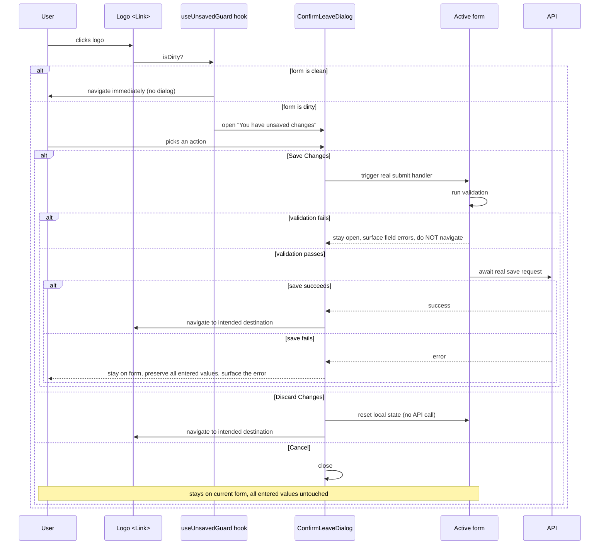

# BRENTIS HEALTHCARE — Logo Navigation & Unsaved-Form Protection Spec

**Status:** Design specification only. **Nothing in this document has been implemented.** Prompt 2 of this workflow implements against it. Research performed via direct code reading (`grep`/file inspection) of `apps/web/src` — see §1 for exact file:line references.

---

## 1. Current architecture (as it exists today, verified by direct code reading)

### Logo click behavior today
- **Customer header** (`src/components/layout/Header.tsx:282-299`): a plain `<Link to="/">` wrapping the logo mark. Standard React Router navigation, no interception of any kind.
- **Customer account area** (`CustomerLayout.tsx:26` → `Sidebar.tsx:95-113`): `Sidebar` receives `logoHref="/"` and renders a clickable `<Link>` — navigates to the customer homepage.
- **Admin panel** (`AdminLayout.tsx:41-66` → `Sidebar.tsx`): does **not** pass `logoHref` to `Sidebar` — **the admin logo is currently not clickable at all** (static image+text, no link). This is the actual current state, not an oversight this spec needs to "preserve around" — it means there is no existing admin logo-navigation behavior to protect, only new behavior to design.
- **Super Admin**: `SuperAdminLayout.tsx` is `return <AdminLayout />;` — identical to Admin, same non-clickable logo today.

### Routing architecture
- `main.tsx:44` mounts a plain **`<BrowserRouter>`**, not `createBrowserRouter`/`<RouterProvider>` (the "data router"). `AppRouter.tsx:187-334` is one `<Routes>` tree with layout-wrapping `<Route element={...}>` blocks for `PublicLayout`, `AuthLayout`, `CustomerLayout` (behind `ProtectedRoute`), `AdminLayout` (behind `ProtectedRoute requiredRole=[...]`), `SuperAdminLayout` (behind `ProtectedRoute requiredRole=['super_admin']`).
- **This rules out React Router's own `useBlocker`/`unstable_usePrompt`** — both are data-router-only APIs; under a plain `<BrowserRouter>` they throw or no-op. Migrating to `createBrowserRouter` to get them is possible but nontrivial (the route tree uses nested layouts and lazy-loaded route modules) and is explicitly **out of scope for this spec** — the design below works without it.

### Existing dirty-state / leave-guard patterns
**None exist anywhere in the codebase today** (confirmed: zero matches for `beforeunload`, `isDirty`, `useBlocker`, `usePrompt`, or any manual "are you sure" pattern near a form). Every form in this spec is a genuinely new capability, not an extension of an existing one.

### Form library landscape (mixed — the spec must work for both)
| Form | File | Library | Dirty tracking today |
|---|---|---|---|
| Admin product form | `modules/admin/catalog/components/ProductFormDrawer.tsx` | react-hook-form + zod | `formState` destructured but `isDirty` not currently read (line 84) — trivial to add |
| Admin "config entity" CRUD (categories, brands, etc.) | `components/table/ConfigEntityPage.tsx` | react-hook-form + `FormProvider` | Same — `isDirty` available from `formState`, not yet read |
| Customer profile | `modules/customer/pages/ProfilePage.tsx` | Plain `useState` per section (password, phone-change, delete-account) | No shared page-level dirty concept — each section is independently stateful |
| Checkout | `modules/storefront/pages/CheckoutPage.tsx` | Plain `useState` | Not a classic form; has an async **payment-processing** state distinct from "dirty" that needs its own guard (see §5) |
| Prescription upload | `modules/customer/pages/PrescriptionsPage.tsx` | Plain `useState`, async file upload | Upload is a real async operation — a "Save" action here must genuinely await the network call |

## 2. Scope boundary (restated, not re-litigated)

Per this prompt's explicit instructions: **admin layout, sidebar, topbar, styling, and business logic are not to be touched.** This spec only adds:
1. A new, shared, reusable confirmation-dialog component (new file, not a modification to any existing shared primitive).
2. A new, small dirty-state-tracking hook/utility, opt-in per form.
3. A click-interception wrapper around the logo `<Link>` in `Header.tsx`, `Sidebar.tsx` (for the account area), and — as **new** behavior, since none exists today — an opt-in clickable logo for `AdminLayout`/`SuperAdminLayout` if the business wants one (open question, see §7).

None of this touches `AdminLayout.tsx`'s own styling, the sidebar's visual design, or any admin business logic beyond the one new click-interception wrapper.

## 3. UX flow

## 4. Dialog content (exact copy, per the brief)

**Title:** You have unsaved changes
**Body:** You have unsaved changes on this page. What would you like to do?
**Actions (in this order):** **Save Changes** (primary) · **Discard Changes** (destructive/secondary) · **Cancel** (tertiary/close)

## 5. Behavior contract, precisely

- **Save Changes** calls the form's *actual* existing submit handler — never a parallel/duplicate save path. For react-hook-form forms (`ProductFormDrawer`, `ConfigEntityPage`), this means programmatically triggering `handleSubmit(onSubmit)()` and awaiting it. For plain-`useState` forms (`ProfilePage`, `PrescriptionsPage`), it means awaiting the relevant existing `mutateAsync`/async handler for whichever section is actually dirty. Validation runs exactly as it does on a normal manual submit — no bypass. Navigation happens **only after** the save promise resolves successfully. On failure, the dialog closes (or stays, per §7 open question) but **navigation does not happen** and all field values remain exactly as entered — the error surfaces the same way a normal failed submit already does on that form.
- **Discard Changes** clears only the in-memory dirty state (react-hook-form `reset()`, or clearing the relevant `useState` back to its last-saved value) — no API call, then navigates immediately.
- **Cancel** closes the dialog with zero side effects; the user stays exactly where they were, with every entered value intact (the dialog must not have mutated any form state while open).
- **The async-save requirement is non-negotiable for `PrescriptionsPage`** specifically: a file upload is a real, potentially multi-second network operation — "Save Changes" there must show the form's own existing in-flight/uploading state (`isUploading`) and keep the dialog's own buttons disabled until that resolves, never navigate on a merely-started-but-not-finished upload.
- **`CheckoutPage`'s payment-processing state is a different kind of guard, not a dirty-form guard** — mid-payment (Razorpay modal open / webhook pending), the correct behavior is almost certainly to block logo navigation outright with a simpler "payment in progress" message rather than offer Save/Discard/Cancel (discarding a payment isn't a safe or meaningful concept). This spec flags it as a distinct case rather than forcing it into the generic dialog — a decision for Prompt 2 to confirm, not to resolve unilaterally here.

## 6. Implementation shape (for Prompt 2, not built here)

- **New hook**, e.g. `useUnsavedChangesGuard({ isDirty, onSave, onDiscard })` — framework-agnostic over the two form patterns (accepts any `isDirty: boolean` and `onSave: () => Promise<void>`, so both react-hook-form's `formState.isDirty` and a manually-tracked `useState` boolean satisfy it identically).
- **New shared dialog component**, e.g. `components/common/UnsavedChangesDialog.tsx` — a genuinely new file (not a modification to any existing shared primitive like `Modal`/`Dialog`, though it may *compose* the existing one if one already exists in `components/common/`).
- **Logo click interception**: wrap the existing `<Link to="/">` (customer) / `<Link to={logoHref}>` (account-area Sidebar) in an `onClick` that calls `event.preventDefault()` + consults the guard only when a dirty form is actually mounted on the current page (most pages have no active form at all, and must navigate instantly with zero added latency or dialog flicker — the guard should be a no-op by default, opt-in per page via context or a prop, not a global interceptor that has to ask "is anything dirty?" on every single click across the whole site).
- **Admin/Super Admin logo**: since neither currently has a clickable logo at all, making it clickable is itself new, additive behavior (adding `logoHref="/admin"` / `logoHref="/superadmin"` to the existing `Sidebar` prop it already supports) — the unsaved-guard wraps that *new* link the same way, once the business confirms it's wanted (§7).

## 7. Open questions for the business owner / Prompt 2 (not decided here)

1. Should the Admin/Super Admin logo become clickable at all? It isn't today, and "preserve existing work" cuts toward not assuming this is wanted — but the brief asks for "Admin logo: Navigate to admin dashboard/homepage," which implies it should be. Flagging rather than silently deciding.
2. For `CheckoutPage`'s in-flight-payment case (§5): block outright, or still offer a (different) dialog? Recommend blocking outright, but not decided here.
3. Browser-native back/refresh/close protection (the brief's "also plan protection for browser back navigation and refresh/close behavior") needs a `beforeunload` listener for refresh/close (straightforward, browser-native, shows the browser's own generic warning, not custom copy — browsers no longer allow custom `beforeunload` message text) and, separately, a `popstate`-based intercept for the in-app browser-back-button case (same dirty-state check, same dialog) — both additive, not requiring the `createBrowserRouter` migration.
